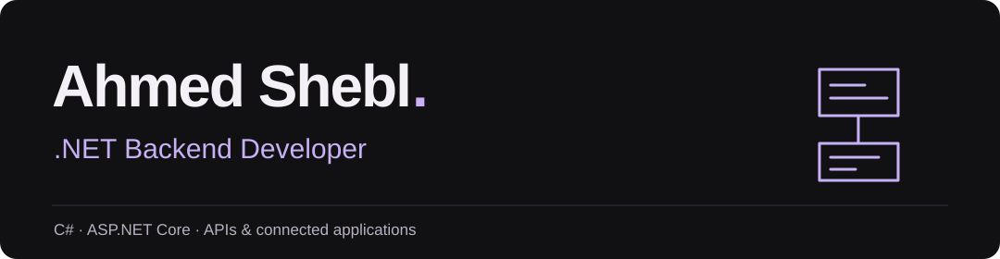
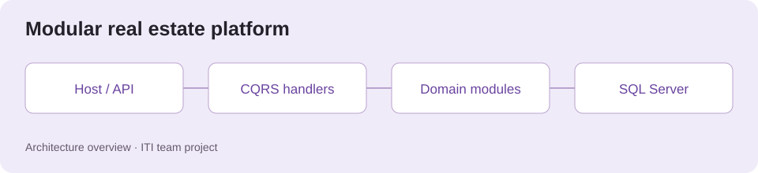
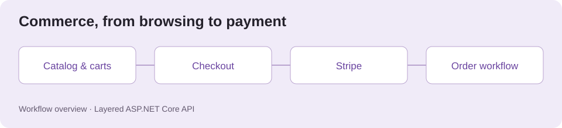
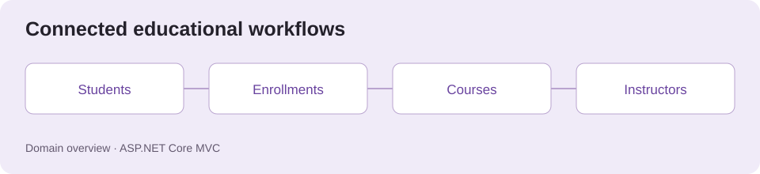

I build APIs and connected applications with **C# and ASP.NET Core**, bringing a Business Information Systems perspective to the workflows behind the code. Currently a **Backend Developer Intern at AppsSquare**, working on **Paymob integration** and **Kamakan** during a three-month internship that began in September 2026.

[Explore my portfolio](https://ahmedshiple2015.github.io/ahmed-shebl-portfolio/) · [LinkedIn](https://www.linkedin.com/in/ahmed-shebl1912/) · [Email](mailto:ahmed.shiple2015@gmail.com)

## Selected work

### [Real Estate Management Platform](https://github.com/kandeel11/Real-Estate-ITI-Graduation-Project)

<picture>
  <source media="(prefers-color-scheme: dark)" srcset="assets/real-estate-dark.svg">
  <source media="(prefers-color-scheme: light)" srcset="assets/real-estate-light.svg">
  
</picture>

Property listings, leases, maintenance, and payments in a modular .NET 10 application.

**My role: Backend Architect & Team Lead** on the ITI graduation team. Architecture highlights include nine bounded modules, CQRS/MediatR, Host adapters, and Outbox integration events. The repository contains the team's shared implementation.

**Explore:** [Architecture, payments, and AI walkthrough](https://ahmedshiple2015.github.io/ahmed-shebl-portfolio/#work) · [Team source](https://github.com/kandeel11/Real-Estate-ITI-Graduation-Project)

### [E-Commerce API](https://github.com/ahmedshiple2015/E-Commerce-API)

<picture>
  <source media="(prefers-color-scheme: dark)" srcset="assets/commerce-api-dark.svg">
  <source media="(prefers-color-scheme: light)" srcset="assets/commerce-api-light.svg">
  
</picture>

A layered .NET 8 API covering catalog, guest carts, checkout, and seller workflows.

**My focus: Backend development.** API, Application, Domain, and Infrastructure layers organize the code; JWT/Identity, ownership checks, guest access tokens, and Stripe connect browsing to checkout.

[Explore the source](https://github.com/ahmedshiple2015/E-Commerce-API)

### [Educational Management](https://github.com/ahmedshiple2015/MVCProject)

<picture>
  <source media="(prefers-color-scheme: dark)" srcset="assets/education-dark.svg">
  <source media="(prefers-color-scheme: light)" srcset="assets/education-light.svg">
  
</picture>

An ASP.NET Core MVC application connecting students, instructors, courses, and departments.

**My focus: Full stack .NET development.** EF Core maps enrollments and assignments, Identity separates Admin and Student roles, and repositories and Razor views organize the workflows.

[Explore the source](https://github.com/ahmedshiple2015/MVCProject)

## Core toolkit

**C# · ASP.NET Core · EF Core · SQL Server**  
**Payments:** Paymob · Stripe &nbsp; | &nbsp; **Architecture:** CQRS · MediatR · Outbox

More technologies, projects &amp; background

**Frontend:** Angular · TypeScript · JavaScript · HTML · CSS · Bootstrap  
**Integrations & delivery:** SignalR · Semantic Kernel · Qdrant · n8n · Azure · Docker · GitHub Actions

- [Ecobazar](https://github.com/ahmedshiple2015/CST-E-commerce-Project): team frontend commerce demo using ES6 modules, OOP, and browser storage. My role: Front-End Architect & Developer. The linked repository is a team-project fork.
- [Personal portfolio](https://github.com/ahmedshiple2015/ahmed-shebl-portfolio): React, responsive project showcases, persistent light/dark themes, and playable mini-games.

**Education**

- ITI — Full Stack & Generative AI Intensive Code Camp, January–July 2026.
- Tanta University — Bachelor of Business Information Systems, July 2025; GPA 3.22/4.00.

**Based in:** Tanta, Egypt; ready to relocate.  
**Languages:** Arabic (native) · English (C1).

## Let's connect

Have a backend role or a .NET project in mind? [Email me](mailto:ahmed.shiple2015@gmail.com) or [connect on LinkedIn](https://www.linkedin.com/in/ahmed-shebl1912/).

## A little off-duty code

[Play Snake or Backend Match](https://ahmedshiple2015.github.io/ahmed-shebl-portfolio/#play) — keyboard and mobile controls included.

<picture>
  <source media="(prefers-color-scheme: dark)" srcset="assets/contribution-snake-dark.svg">
  <source media="(prefers-color-scheme: light)" srcset="assets/contribution-snake.svg">
  
</picture>

Updated daily with [Platane/snk](https://github.com/Platane/snk).
